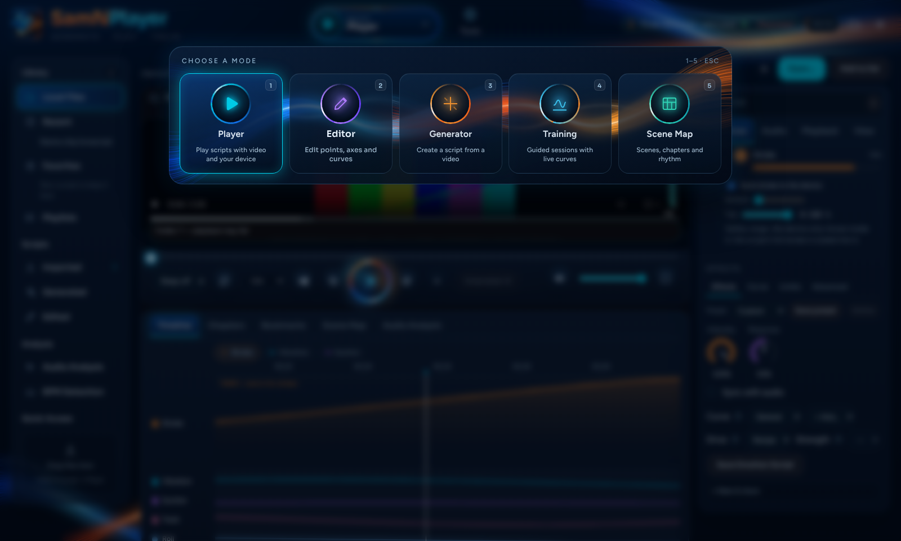
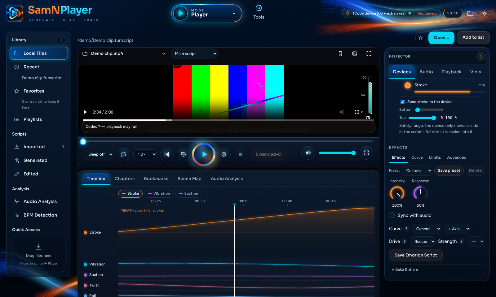
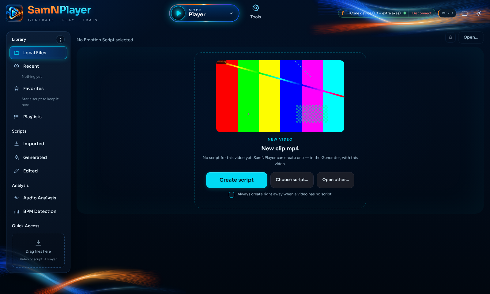
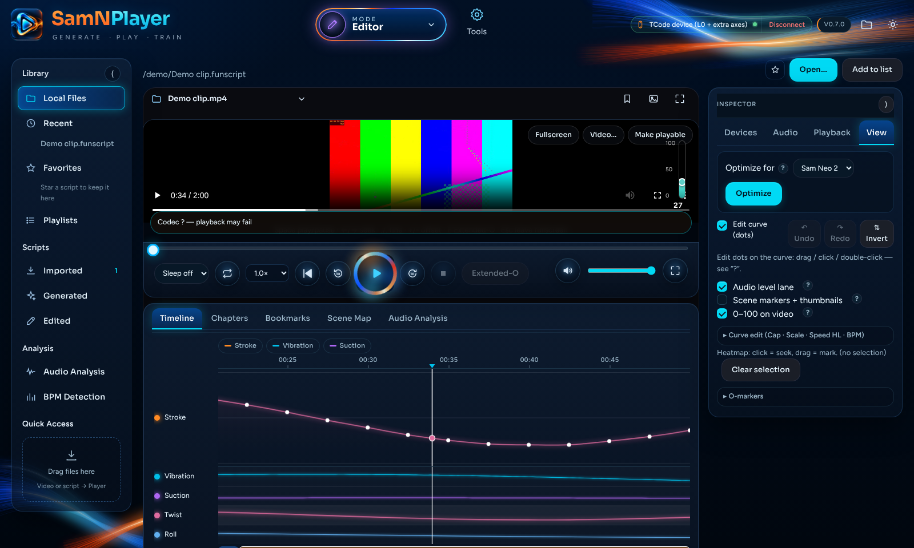
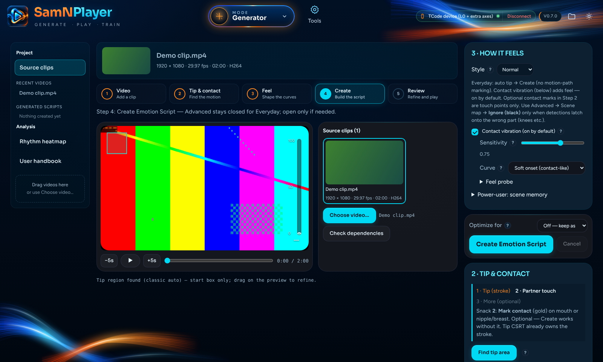
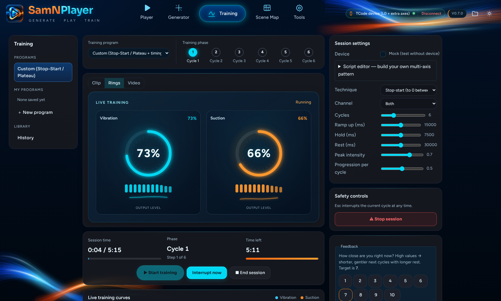
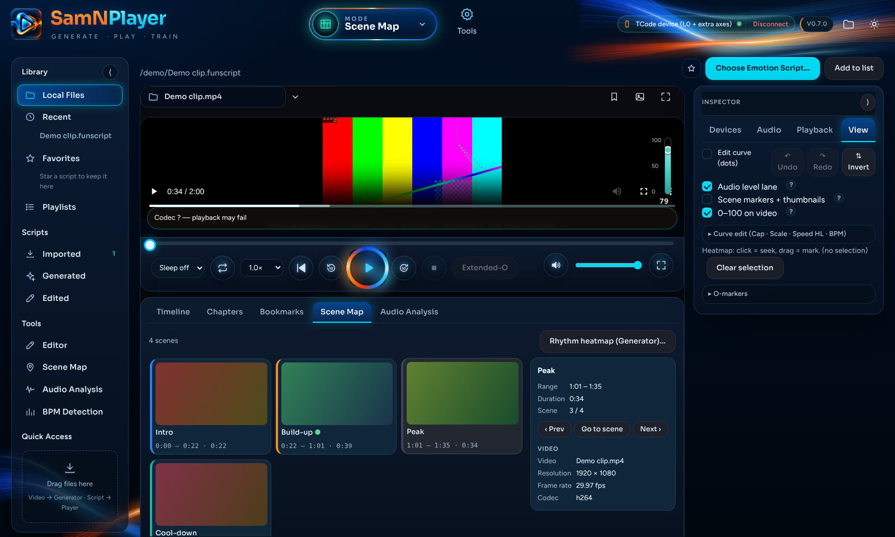
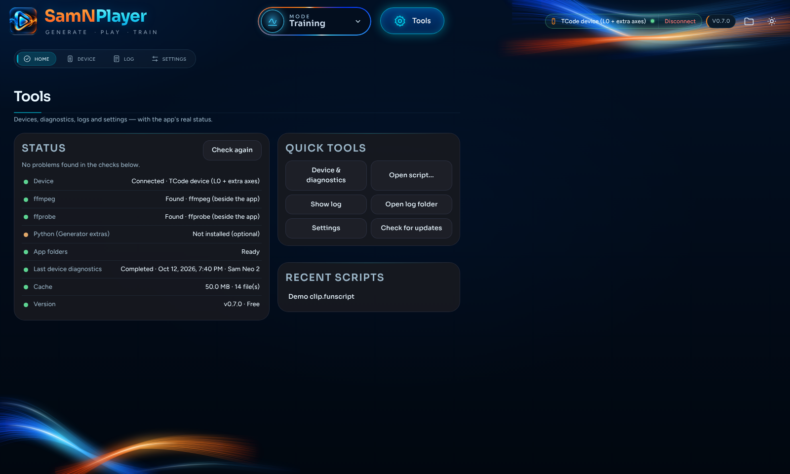
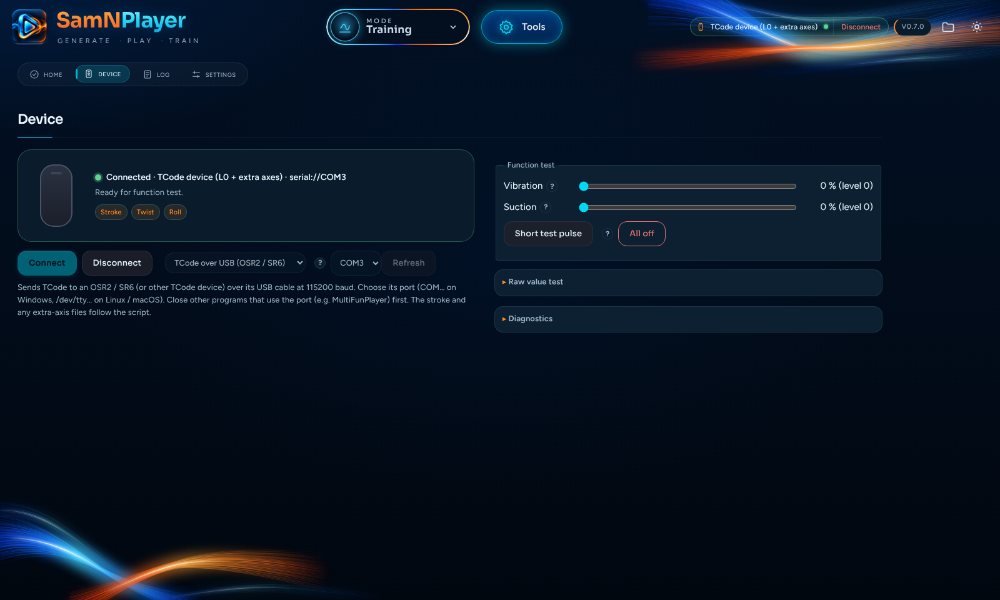

<p align="center">
  
</p>

<h1 align="center">SamNPlayer</h1>

<p align="center">
  <strong>Generate · Play · Train</strong> — a free, local desktop app for
  <code>.samn</code> / <code>.funscript</code> scripts. Made for the SVAKOM Sam&nbsp;Neo&nbsp;2,
  and open to strokers and other devices.
</p>

<p align="center">
  <a href="https://github.com/funfunpayer/SamNPlayer/releases"></a>
  <a href="https://github.com/funfunpayer/SamNPlayer/actions/workflows/tests.yml"></a>
  
  
  
</p>

<p align="center">
  <a href="#the-modes">Modes</a> ·
  <a href="#devices">Devices</a> ·
  <a href="#download">Download</a> ·
  <a href="#build-from-source">Build</a> ·
  <a href="CHANGELOG.md">Changelog</a> ·
  <a href="docs/USER_HANDBOOK.md">Handbook</a>
</p>

---

## One player, five modes

SamNPlayer is one window. The **Mode** pill at the top switches what the
window does — **Player**, **Editor**, **Generator**, **Training** or
**Scene Map**. The video, the transport and the timeline look the same in
every mode; only the tools around them change. **Tools** (device, log,
settings) sits next to the pill.

<p align="center">
  
  <br />
  <em>The Mode deck</em> — click the pill or press <kbd>M</kbd>, then 1–5
</p>

## The modes

### Player

Play a script with its video and your device. The big Play button is the
app's symbol. The Library is on the left and the Inspector on the right
(devices, audio, playback, view); both slide away for more room. The
timeline below shows one colour-coded lane per channel. A fast script seen
from far away becomes a calm **tempo** wave, and zooming in shows the
single strokes.

<p align="center">
  
</p>

**Open a video or a script** with the big *Open…* in the empty Player, with
Ctrl+O, or by dropping it onto the window. A video brings its script along
when one with the same name lies beside it. If there is none, the Player
offers to create one: *Create script* opens the Generator with that video.

<p align="center">
  
</p>

### Editor

The Player with editing on: drag, add or delete points on any channel,
use undo / redo and range tools (cap, scale, speed highlight, BPM). Use
**Optimize for** to prepare a script for *any device* (fill and heal gaps)
or for the *Sam Neo 2* (also contact vibration and baked vibration +
suction).

<p align="center">
  
</p>

### Generator

Make a script from your own video in five steps: video → tip & contact →
feel → create → review. Classical tracking does the work; local AI may
*suggest* (tip region, scene type, profile), and nothing is written
without you. **Optimize for** can prepare the new script for a device right
after Create.

<p align="center">
  
</p>

### Training

Guided sessions — stop-start, plateau or a program with phases — with live
rings, live curves next to the planned target, and a session timeline. In
the middle sit **End · Play/Pause · Interrupt**: Pause really holds the
device at 0 and stops the clock. The rings follow your device: a vibrator
shows only vibration, and a stroker without vibration or suction cannot
start a session that would do nothing.

<p align="center">
  
</p>

### Scene Map

The script's chapters as scenes: thumbnails, ranges, details and
prev / next, next to the video. The Generator's rhythm heatmap is one
click away.

<p align="center">
  
</p>

### Tools

Home (status at a glance), Device (connection and diagnostics), Log and
Settings.

<p align="center">
  
  
</p>

---

## Devices

| Device | How | Channels |
|---|---|---|
| **SVAKOM Sam Neo 2 / Neo 2 Pro** | Bluetooth (own driver), or Intiface | Vibration, suction, with diagnostics and battery. First-class. |
| **Strokers** — The Handy, OSR2 / SR6 and other TCode devices | Intiface, or TCode over Wi-Fi / USB | Stroke positions, plus extra axes on multi-axis strokers |
| **Vibrators and other toys** | Intiface (Buttplug) | Every motor, suction / constrict, rotate |
| **Mock** | built in | Test without a device |

The app shows what the connected device can do. Details:
[`docs/DEVICE_SUPPORT.md`](docs/DEVICE_SUPPORT.md).

**Bluetooth on Windows 11:** Intiface recommends an external dongle with an
antenna (for example TP-Link UB500), not bare onboard radios —
[hardware guidance](https://intiface.com/docs/intiface-central/hardware/bluetooth/).

---

## Why SamNPlayer

| | Typical alternatives | **SamNPlayer** |
|---|---|---|
| Size | Electron, often 100+ MB | **~13 MB** native GUI ([Wails](https://wails.io), the system webview) |
| Scope | Play *or* generate | **Play, edit, generate and train** in one window |
| AI | Cloud, bundled weights, or AI-written scripts | **Optional and local** — AI suggests, classical tracking writes |
| Privacy | Telemetry and downloads are common | **Local only** — no cloud calls, no surprise downloads |
| Video tools | "Install ffmpeg yourself" | The **portable** archive ships ffmpeg next to the app |
| Quality | "Looks fine" | Quality Doctor, Script Doctor, benchmark — numbers before claims |

---

## Download

Releases are on the
[releases page](https://github.com/funfunpayer/SamNPlayer/releases). Take
the **portable** archive (`SamNPlayer-portable-*-amd64`): it has `ffmpeg`
and `ffprobe` next to the app. The app updates itself from GitHub
releases and checks each download's checksum.

| Platform | Today | Later |
|---|---|---|
| Windows / Linux | GUI + CLI + portable ffmpeg | — |
| macOS | code ready, no release binary yet | signed `.app` |
| iPhone / Android | — | Player only |

SamNPlayer is **freeware** with an EULA. There is no licence key; voluntary
donations keep the project going.

---

## Build from source

> The application source is private; team members only.

Needs Go and Node / npm.

```bash
go build ./cmd/cli                                 # CLI
cd cmd/gui-wails && wails build -tags webkit2_41   # GUI (Linux / WebKitGTK 4.1)
```

Windows GUI from Linux:

```bash
cd cmd/gui-wails
GOOS=windows GOARCH=amd64 wails build -platform windows/amd64 \
  -ldflags "-X github.com/funfunpayer/SamNPlayer/update.Version=v$(cat ../../VERSION)"
```

Tests: `go test ./...` and the frontend suites in
`cmd/gui-wails/frontend/test/` (Playwright). Screenshots:
`python3 scripts/screenshots/capture_gui.py`.

Generator extras need **Python 3.9+** (`pip install -r generator/requirements.txt`);
optional local AI: `generator/requirements-ai.txt`.

---

## How AI fits, and where it stops

```text
  Video ──► [optional local AI: tip region, scene type, profile — suggestions]
                 │  (you apply them — never silent)
                 ▼
           Classical tracker (CSRT + rhythm lock)
                 │
                 ▼
           Script + Quality Doctor
```

There is no AI-only path that writes a script on its own. Details:
[`docs/AI_ADAPTER.md`](docs/AI_ADAPTER.md),
[`docs/ENGINEERING_STANCE.md`](docs/ENGINEERING_STANCE.md).

---

## In numbers

About **122 000 lines** of code and tests, plus 16 000 lines of docs
(non-blank lines, without generated or third-party files; counted
14 Oct 2026 with `python3 scripts/count_lines.py`).

| Language | Files | Code | Tests |
|---|---:|---:|---:|
| Go — app, devices, player, Generator core | 443 | 38 148 | 22 395 |
| JavaScript — interface | 40 | 20 638 | — |
| Python — AI and tracking helpers; interface tests | 243 | 19 077 | 15 127 |
| CSS / HTML | 19 | 6 448 | — |
| Shell / PowerShell | 6 | 609 | — |
| **Total** | **751** | **84 920** | **37 522** |

The interface is tested in a real browser (Playwright); those tests are
the Python test lines.

---

## Docs

| Doc | What it is |
|---|---|
| [`docs/USER_HANDBOOK.md`](docs/USER_HANDBOOK.md) | Handbook (also in the app) |
| [`docs/owner/`](docs/owner/) | Owner guides (German), including [what only the Owner can do](docs/owner/owner-aufgaben.md) |
| [`docs/DEVICE_SUPPORT.md`](docs/DEVICE_SUPPORT.md) | Devices and channels |
| [`docs/EVERYDAY_GENERATE.md`](docs/EVERYDAY_GENERATE.md) | The everyday Generator path |
| [`docs/EDITIONS.md`](docs/EDITIONS.md) | Free and Suite editions |
| [`docs/PLATFORMS.md`](docs/PLATFORMS.md) | Platforms |
| [`CHANGELOG.md`](CHANGELOG.md) | What changed |
| [`HANDOFF.md`](HANDOFF.md) | Architecture, and what was tested and rejected |

---

## Contributing

See [CONTRIBUTING.md](CONTRIBUTING.md): one manageable task at a time,
regression tests for behaviour changes, measurements instead of vibes.
Shipped UI and docs are English.

License: freeware with EULA, proprietary source — see [LICENSE](LICENSE).
